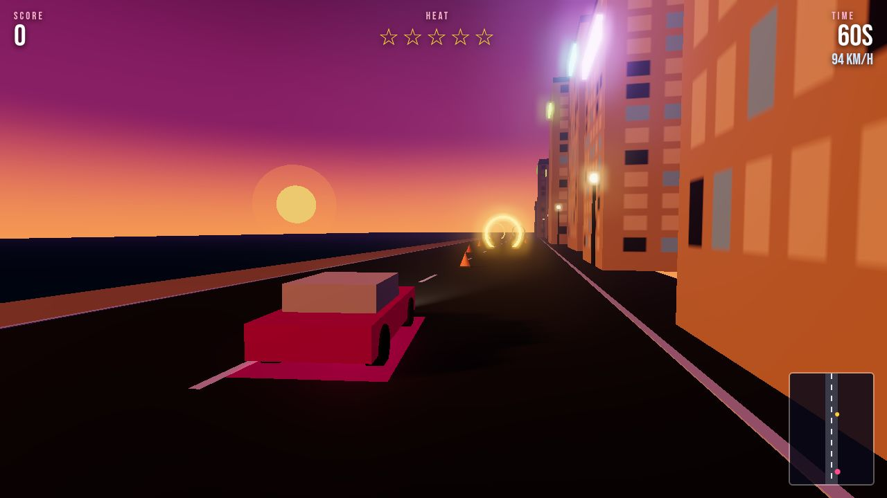
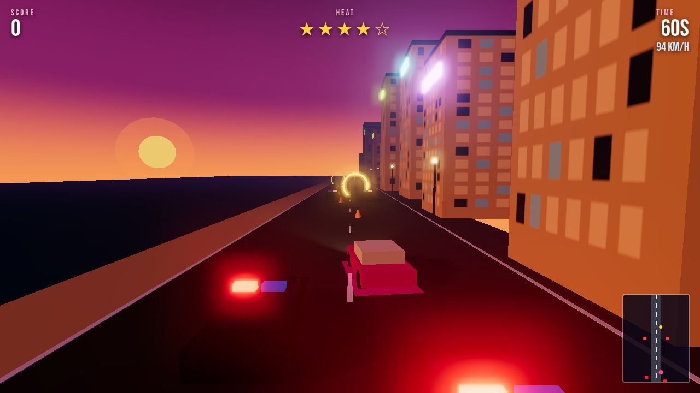
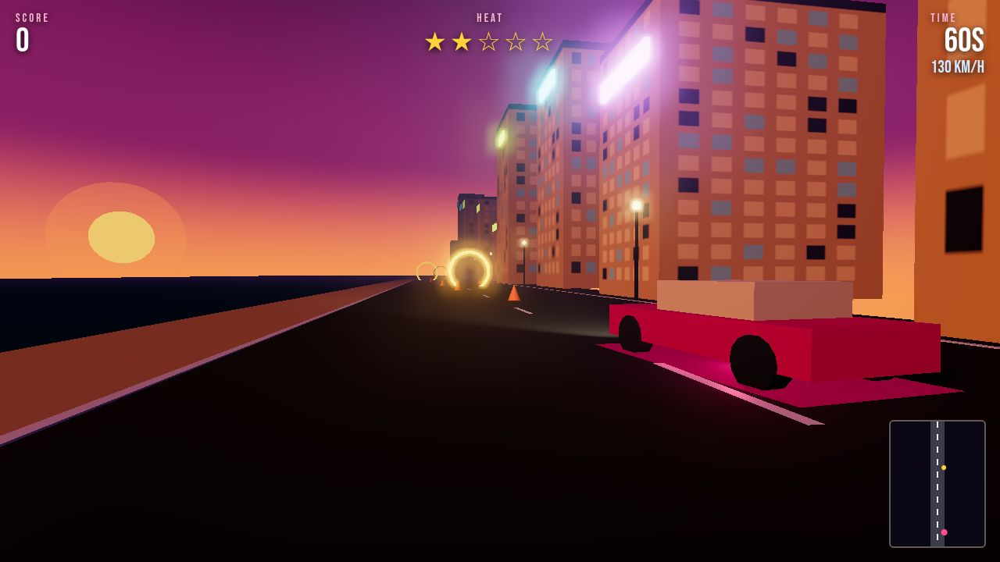
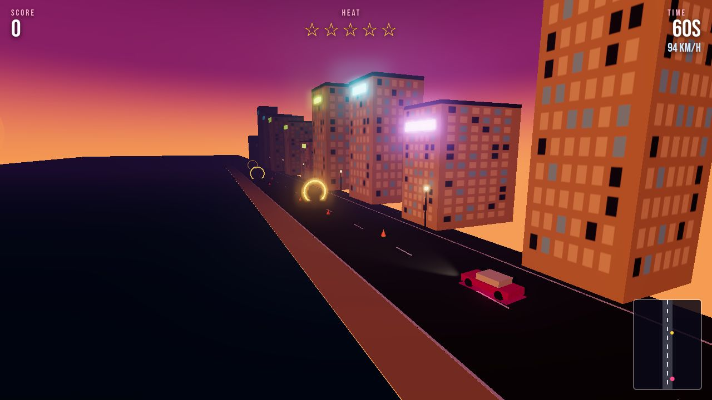

# Neon Bay: Heat Run

A neon highway pursuit for [make.fun's Make GTA 6 bounty](https://make.fun/bounty/gta6-01). Drive the pink car down Ocean Drive at dusk, outrun the police, thread the glowing checkpoint rings, and beat the clock.

## How to play

- **WASD or arrow keys** to drive, **Space** to brake, **P** or **Escape** to pause.
- Drive through a glowing ring: **+100 points, +5 seconds**.
- Near-miss a traffic cone at speed: **+25 points**.
- Speeding and being seen by the police raises your heat (0 to 5 stars). At 3+ stars a roadblock appears ahead. Get caught while slow and you are busted.
- The clock starts at 60 seconds. Rings buy you more time.

## The game

- Three.js open-world drive: a straight neon highway with a pastel skyline on one side and the teal ocean on the other, ACES tone mapping, bloom, dusk sun and shadows.
- Wanted system: 2 to 3 police cruisers chase and ram, with flashing light bars and a roadblock at 3+ stars.
- Fixed 1/60 timestep with a seeded RNG: the same seed always plays the same run.
- HUD with score, wanted stars, timer, speed and a live minimap.

Built for the bounty at https://make.fun/r/mc9159gw
